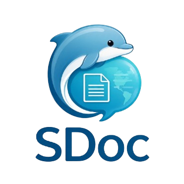

<p align="center">
  
</p>

<h1 align="center">SDoc</h1>

<p align="center"><strong>一个轻量、极速、现代化的中文技术文档站。</strong></p>

<p align="center">
  <a href="https://github.com/eonsee/sdoc/blob/main/LICENSE"></a>
  <a href="https://github.com/eonsee/sdoc/pulls"></a>
  <a href="https://astro.build"></a>
</p>

**SDoc** 是一个基于 [Astro](https://astro.build) 与 [Nimbus](https://github.com/cloudflare/nimbus) 构建的静态文档站点，用来沉淀值得反复查阅的技术内容。它把长文教程、项目文档和开发笔记整理成结构清晰、可全文检索、适配手机阅读的在线手册。

当前站点主要收录两套内容：

- **能碳管理系统实战教程**：基于若依（RuoYi）从零设计并实现一套工厂能碳管理系统。内容覆盖业务架构、技术选型、现场仪表与接线、若依模块与数据库、采集服务、碳核算，以及部署验收。硬件部分从零讲起，适合没有电气背景的开发者。
- **Nimbus 中文指南与开发笔记**：包括页面编写、组件使用等中文文档，以及日常开发中的实践记录。

## ✨ 站点特性

- **静态优先，加载快**：构建期生成 HTML，部署后直接由 CDN 分发。
- **MDX 写作**：以 Markdown 为主，需要时可以在文档中直接嵌入交互组件。
- **全文检索**：内置 Pagefind 本地搜索，不依赖外部搜索服务。
- **明暗主题**：支持跟随系统或手动切换，桌面与手机均有响应式布局。
- **分享卡片**：每篇文档在构建时生成 OG 图片，分享链接有完整预览。
- **对 Agent 友好**：同时输出 `llms.txt`、`llms-full.txt` 和每页的 Markdown 版本。

## 📚 内容结构

能碳教程按“先设计、再选型、后实现”的顺序组织，建议从教程导读开始阅读：

| 章节 | 内容 |
| --- | --- |
| 教程导读 | 目标场景、读者画像、术语表与学习路径 |
| 架构设计 | 业务边界、功能架构、数据流、碳核算公式与部署架构 |
| 技术栈 | 若依版本对比、后端/前端、MySQL/Redis/TDengine、EMQX 与工业协议 |
| 硬件详解 | 电表与互感器、水气汽计量、RS-485、网关、点位表、施工调试与选型清单 |
| 若依实现 | 模块划分、核心表结构、采集服务、碳核算服务、前端页面与权限 |
| 部署运维 | Docker Compose、Nginx、HTTPS、EMQX ACL、备份、监控与上线检查 |

正文位于 `src/content/docs/`，其中能碳教程在 `src/content/docs/nengtan/`。

## 🛠️ 本地运行

环境要求：Node.js 20+ 与 npm。

```bash
git clone https://github.com/eonsee/sdoc.git
cd sdoc
npm install
npm run dev
```

开发服务器默认运行在 <http://localhost:4321>。

常用命令：

| 命令 | 作用 |
| --- | --- |
| `npm run dev` | 启动本地开发服务器，保存后自动刷新 |
| `npm run build` | 生成静态站点到 `dist/` |
| `npm run preview` | 本地预览构建结果 |
| `npm run typecheck` | 运行 `astro check` 类型检查 |
| `npm run lint:docs` | 检查文档的 frontmatter 与内部链接 |
| `npm run lint:docs:fix` | 自动修复可以安全修复的文档问题 |

## 🗂️ 项目结构

```text
.
├── astro.config.ts          # 站点配置、侧边栏与 Nimbus 集成
├── public/                  # 静态资源：Logo、favicon 等
├── src/
│   ├── components/          # Header、Logo 与 UI 组件
│   ├── content/docs/        # 所有文档页面（.mdx）
│   ├── layouts/             # 页面布局
│   ├── pages/               # 路由、OG 图片、llms.txt 等
│   └── styles/              # 全局样式与正文排版
├── sdoc_logo.png            # 原始 Logo（README 使用）
├── vercel.json              # Vercel 构建配置
└── package.json
```

## 🚀 部署

仓库已配置 Vercel：推送到 `main` 分支后会自动执行 `npm run build`，并将 `dist/` 作为静态站点发布。

在 Vercel 上构建时，`astro.config.ts` 会读取 `VERCEL_PROJECT_PRODUCTION_URL` 生成规范链接、OG 图片地址、`robots.txt` 和站点地图；本地构建则回退到占位地址。如果部署到其他平台，请把 `site` 改成你的正式域名。

## 🤝 贡献

欢迎提交 Issue 或 Pull Request。修改文档时，请保持“一篇页面只讲一个主题”，并在提交前运行：

```bash
npm run lint:docs
npm run build
```

## 📄 License

本项目基于 [MIT License](./LICENSE) 开源。
